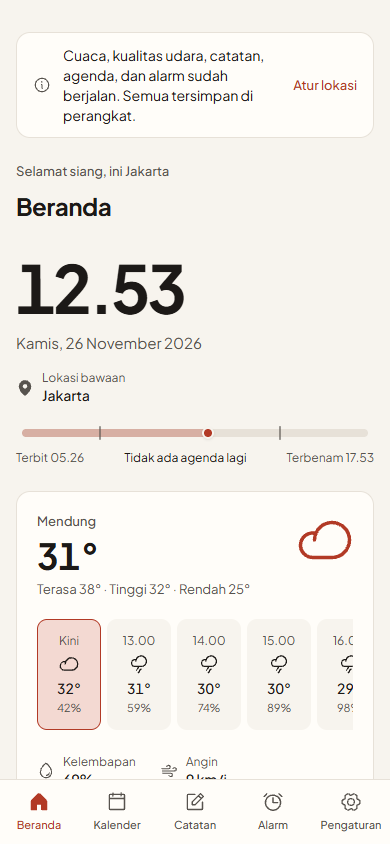
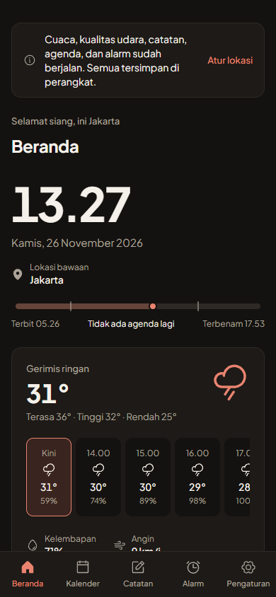
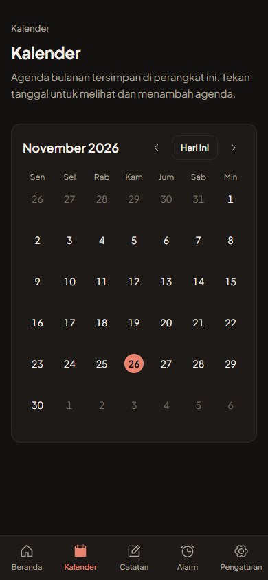
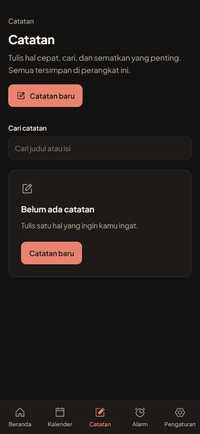
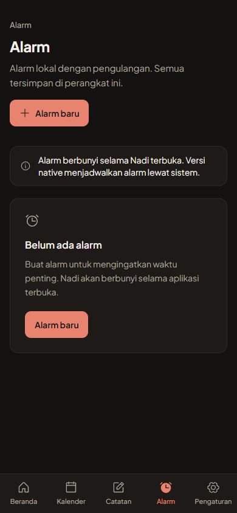
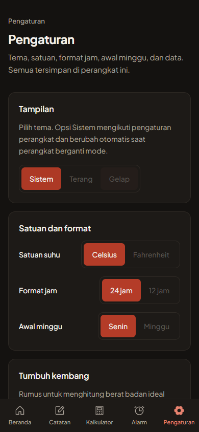
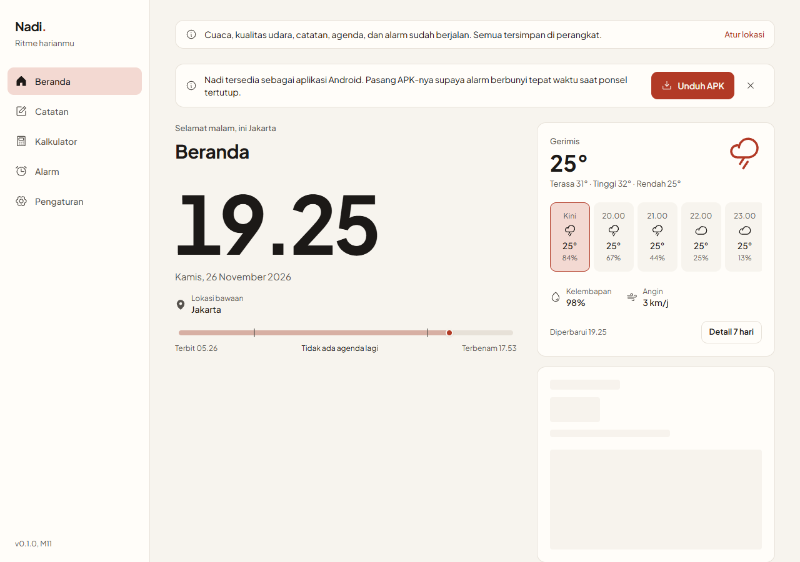

# Nadi

Aplikasi web progresif untuk jam, cuaca, kualitas udara, agenda, catatan, dan alarm dalam satu dasbor.

Status: M8 selesai dan pembungkus Capacitor (M10) sudah berjalan. Pengaturan lengkap, ekspor dan impor JSON, hapus data, audit offline, aksesibilitas, performa, uji lintas mesin, dan alarm native Tier 1 sudah ada. Berikutnya M9 rilis dan Tier 2 alarm layar penuh.

## Tangkapan layar

| Beranda (terang)                                          | Beranda (gelap)                                         | Kalender                                      |
| --------------------------------------------------------- | ------------------------------------------------------- | --------------------------------------------- |
|  |  |  |

| Catatan                                     | Alarm                                   | Pengaturan (gelap)                                      |
| ------------------------------------------- | --------------------------------------- | ------------------------------------------------------- |
|  |  |  |

Tampilan desktop memakai rail samping: 

## Menjalankan

```
npm install
npm run dev
```

Buka `http://localhost:5173`. Port bisa berbeda jika sudah dipakai proyek lain, cek keluaran Vite.

## Skrip

| Skrip                   | Fungsi                                         |
| ----------------------- | ---------------------------------------------- |
| `npm run dev`           | Server pengembangan                            |
| `npm run build`         | Cek tipe lalu build produksi                   |
| `npm run preview`       | Pratinjau hasil build                          |
| `npm test`              | Unit test sekali jalan                         |
| `npm run test:watch`    | Unit test mode pantau                          |
| `npm run lint`          | ESLint                                         |
| `npm run typecheck`     | Cek TypeScript                                 |
| `npm run smoke`         | Uji asap Chrome ke pratinjau produksi          |
| `npm run smoke:engines` | Uji alur inti di Firefox dan WebKit            |
| `npm run screenshots`   | Perbarui tangkapan layar di `docs/screenshots` |
| `npm run cap:sync`      | Salin bundel web ke proyek Android             |
| `npm run sound`         | Buat ulang bunyi alarm bundel                  |

Uji asap dan tangkapan layar butuh pratinjau produksi yang berjalan:

```
npm run build
npm run preview -- --port 4173 --strictPort
npm run smoke
npm run smoke:engines
```

Atur `SMOKE_BASE_URL` bila pratinjau berjalan di port lain.

## Keputusan desain

- Nama **Nadi**, tagline "Ritme harianmu dalam satu layar". Bahasa antarmuka Indonesia.
- Enam modul: jam, cuaca, kalender, catatan, alarm, kualitas udara. Beranda menyatukan semuanya.
- Tema terang dan gelap, mengikuti sistem secara default, dengan preferensi tersimpan.
- Tanpa backend. Cuaca, kualitas udara, dan geocoding memakai Open-Meteo. Semua data pengguna tersimpan di perangkat lewat IndexedDB (Dexie).
- Sumber kebenaran pengaturan adalah `settings.app` di Dexie. Tema dan awal minggu dicerminkan ke `localStorage` agar bisa dipakai sebelum render pertama.
- Warna kategori AQI memakai skala adaptif, bukan warna resmi mentah, agar tetap lolos kontras di layar terang.

## Versi native (Android)

Web dan PWA berjalan tanpa langkah tambahan. Untuk alarm yang berbunyi tepat waktu saat aplikasi tertutup, aplikasi dibungkus Capacitor dan notifikasi dijadwalkan ke sistem.

Membangun APK debug:

```
npm run build
npx cap sync android
cd android
.\gradlew.bat assembleDebug
```

APK ada di `android/app/build/outputs/apk/debug/app-debug.apk`. Pasang lewat sideload (aktifkan "Instal dari sumber tidak dikenal"). Untuk hasil build, `android/` memerlukan JDK 17 sampai 21 dan Android SDK; JDK bawaan Android Studio bekerja.

Bunyi alarm ada di `android/app/src/main/res/raw/alarm.wav` dan bisa dibuat ulang dengan `node scripts/make-alarm-sound.mjs`.

## Batasan

- Di web, alarm berbunyi selama aplikasi terbuka. Di pembungkus native, alarm dijadwalkan ke sistem dan berbunyi saat aplikasi tertutup. Alarm layar penuh seperti alarm bawaan (Tier 2) belum dikerjakan.
- Sinkronisasi antar perangkat belum ada. Pakai ekspor dan impor JSON untuk memindahkan data.
- iOS tidak mengizinkan alarm pihak ketiga menembus mode senyap tanpa entitlement Critical Alerts. Android menjadi target utama.
- Instalasi PWA di perangkat nyata menunggu hosting HTTPS (T0.5).

## Dokumen

- [docs/README.md](docs/README.md) - ringkasan dan keputusan proyek
- [docs/PRD.md](docs/PRD.md) - produk dan lingkup
- [docs/DESIGN.md](docs/DESIGN.md) - arah visual dan sistem desain
- [docs/ARCHITECTURE.md](docs/ARCHITECTURE.md) - arsitektur teknis
- [docs/TASKS.md](docs/TASKS.md) - milestone dan task

## Catatan migrasi

Kode notes-app versi lama tersimpan di commit git pertama dengan pesan `snapshot: notes-app sebelum migrasi ke Nadi`. Ikon di `public/icons` masih placeholder sampai identitas final disetujui.

## Lisensi data

Cuaca dan kualitas udara berasal dari Open-Meteo, dengan data CAMS untuk kualitas udara. Penggunaan non-komersial.
